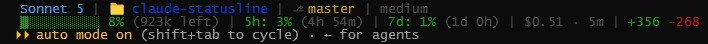

# claude-statusline

Custom status line scripts I use for my [Claude Code](https://claude.com/claude-code) setup. They give a two-line, color-coded, information-dense status line:

- **Line 1:** model name, working directory (+ worktree if any), git branch (+ ahead/behind, staged/modified/untracked counts), open PR (clickable link + review state, if any), effort level / fast mode
- **Line 2:** context usage bar (+ tokens left, 200k warning), 5-hour and 7-day rate limit percentages (+ time until reset), session cost + duration, lines added/removed



There's also a separate, compact status line script for subagents (`subagent-statusline.js`) — see [How the subagent status line works](#how-the-subagent-status-line-works) below for what it actually does.

## Requirements

- [Node.js](https://nodejs.org/) (any recent version, no extra dependencies)
- Claude Code CLI

## Installation

1. Clone this repo or download the files:

   ```bash
   git clone https://github.com/ulaskizilay/claude-statusline.git
   ```

2. Copy `statusline.js` and `subagent-statusline.js` into your `~/.claude/` folder.

   On macOS/Linux:

   ```bash
   cp claude-statusline/scripts/statusline.js ~/.claude/statusline.js
   cp claude-statusline/scripts/subagent-statusline.js ~/.claude/subagent-statusline.js
   ```

   On Windows (PowerShell):

   ```powershell
   Copy-Item claude-statusline\scripts\statusline.js "$env:USERPROFILE\.claude\statusline.js"
   Copy-Item claude-statusline\scripts\subagent-statusline.js "$env:USERPROFILE\.claude\subagent-statusline.js"
   ```

   On Windows (Git Bash/WSL), the macOS/Linux `cp` commands above work as-is.

3. Add the following to your `~/.claude/settings.json` (create it if it doesn't exist, or update the `statusLine` / `subagentStatusLine` fields if it does):

   ```json
   {
     "statusLine": {
       "type": "command",
       "command": "node ~/.claude/statusline.js",
       "padding": 1,
       "refreshInterval": 10
     },
     "subagentStatusLine": {
       "type": "command",
       "command": "node ~/.claude/subagent-statusline.js"
     }
   }
   ```

4. Restart Claude Code (or start a new session). The status line will show up automatically.

## How the main status line works

On every update, Claude Code sends a JSON object over stdin (model info, context window usage, rate limits, cost, git/worktree info, etc.). The script reads that JSON and writes ANSI-colored text to stdout, which Claude Code renders below the prompt. Git branch/ahead-behind/staged info is computed separately inside the script via `git status --porcelain=v2 --branch`, cached per session for ~5 seconds so it doesn't run on every single keystroke.

## How the subagent status line works

When Claude Code runs subagents (via the `Agent`/`Task` tool — e.g. background research agents, forks, parallel workers), each one gets its own row in the UI showing its live progress. `subagentStatusLine` is the script that controls what that row looks like.

- Claude Code sends **one JSON object** on stdin containing an array `tasks[]` — one entry per currently running/finished subagent, with fields like `id`, `name`, `type`, `status` (`running` / `completed` / `failed` / …), `description`, `model`, `effort`, `contextWindowSize`, `tokenCount`.
- For **each** task, the script builds a row: a status icon (▸ running / ✓ completed / ✗ failed), the agent's name, its description, its context-window usage as a percentage + token count, and its model/effort.
- Instead of printing all rows to stdout at once (like the main statusline does), it writes **one JSON line per task**: `{"id": "<task id>", "content": "<formatted row>"}`. Claude Code matches each line back to the corresponding subagent by `id` and uses `content` to override that row's display. Any task the script doesn't emit an id for just keeps its default rendering.

In short: `statusline.js` formats the single line at the bottom of your terminal; `subagent-statusline.js` formats each individual row when you have multiple subagents running at once, so you can see at a glance which one is running, its progress (context %), and what model/effort it's using.

## Project structure

```
claude-statusline/
├── scripts/
│   ├── statusline.js            # main status line renderer
│   └── subagent-statusline.js   # per-subagent row renderer
├── assets/
│   └── screenshot.jpg           # example output
├── README.md
└── LICENSE
```

## Customization

Colors, widths (the context bar is 10 characters), truncate lengths, and the `narrow` (small terminal) threshold (`cols < 90`) are all constants near the top of the file. To add/remove sections from a line, edit the `l1.push(...)` / `l2.push(...)` calls (or the `parts.push(...)` calls in the subagent script).

## License

[MIT](LICENSE) — free to use and adapt for your own setup.
