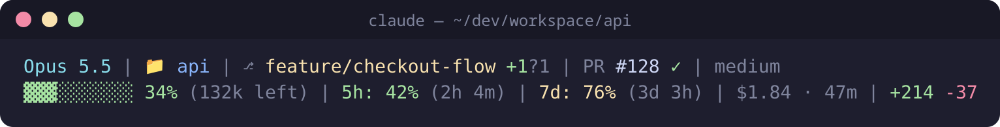
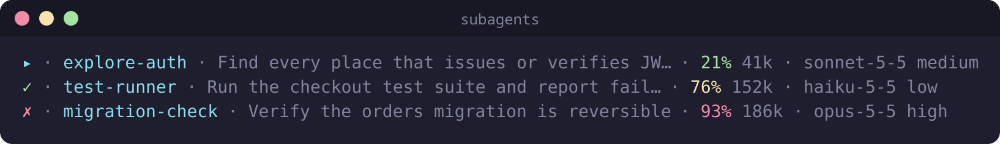
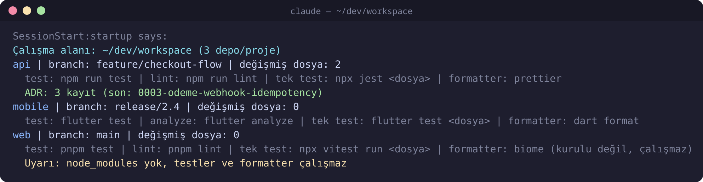

# claude-code-setup

My global [Claude Code](https://claude.com/claude-code) setup: a two-line status line, a set of always-on engineering rules, and two hooks that give every session the project context it needs and keep edited files formatted.

Everything here lives in `~/.claude/`, so it applies to every project without per-repo configuration.



## What's inside

| Path | What it does |
|---|---|
| [`statusline/statusline.js`](statusline/statusline.js) | Two-line status line: model, directory, git state, PR, effort / context usage, rate limits, cost, lines changed |
| [`statusline/subagent-statusline.js`](statusline/subagent-statusline.js) | Compact row per running subagent: status, name, task, context usage, model |
| [`hooks/session-start.sh`](hooks/session-start.sh) | `SessionStart` hook: shows a project summary when a session opens and hands the model the project's commands and existing ADRs |
| [`hooks/format-file.sh`](hooks/format-file.sh) | `PostToolUse` hook: formats every file Claude writes or edits with the project's own formatter |
| [`CLAUDE.md`](CLAUDE.md) | Global rules loaded into every session (written in Turkish, summarized [below](#claudemd-global-rules)) |
| [`settings.json`](settings.json) | The `~/.claude/settings.json` that wires all of the above together |

## Status line

**Line 1:** model, working directory (and worktree), git branch with ahead/behind and staged/modified/untracked counts, the branch's open pull request as a clickable link with its review state, effort level / fast mode.

**Line 2:** context usage bar with tokens left (plus a `200k+` note once a 1M-token session passes 200k input tokens, where long-context pricing applies), 5-hour and 7-day rate-limit usage with time until reset, session cost and duration, lines added/removed.

Percentages turn yellow at 70% and red at 90%. If the `COLUMNS` environment variable is below 90, the line drops the less important parts (reset timers, cost, line counts) and truncates names harder.

Claude Code pipes a JSON payload to the script on stdin on every refresh; the script prints ANSI-colored text back. Git info comes from a single `git status --porcelain=v2 --branch` call, cached per session for 5 seconds so it doesn't run on every keystroke.

Claude Code's payload has no pull request information, so the script asks the GitHub CLI (`gh pr view`) for the current branch's open PR. The result, including "no PR", is cached per repo and branch for 2 minutes, so `gh` runs rarely and the first lookup (about a second) is the only slow one. Repos not hosted on GitHub, or a missing / logged-out `gh`, simply show no PR segment.

### Subagents



When subagents run, `subagentStatusLine` receives one JSON object with a `tasks[]` array and prints one `{"id", "content"}` line per task. Claude Code matches each line to its subagent row by `id`. Each row shows a status mark (running / completed / failed), the agent type (`agentType` in the payload, e.g. `general-purpose` or a custom agent's name), its task, context usage, and model/effort. Tasks the script doesn't emit keep the default rendering.

Note: recent Claude Code versions mark `subagentStatusLine` as deprecated in favor of mods. It still works, but may stop in a future release.

## Session start hook



Runs on startup, resume, `/clear` and after context compaction. It looks at the directory the session was opened in:

| Opened in | Shows |
|---|---|
| A git repo or project folder | Branch, uncommitted file count, test / lint / single-test commands, active formatter, ADR count |
| A folder containing several repos | The same summary for each repo found up to 3 levels deep (git repos only, if there are any) |
| A non-project folder (e.g. `~`) | The 6 most recently used projects, read from Claude Code's own session logs |

It also warns when `node_modules` is missing (tests and the formatter won't run) or when there is a `.env.example` without a `.env`.

The user sees a short summary; the model additionally receives the last commits, the uncommitted changes, every detected command, and the titles and statuses of the most recent ADRs, so it doesn't have to rediscover them each session. After a compaction it also gets a short reminder of the key rules in `CLAUDE.md`.

Commands are detected from `package.json` scripts (npm / pnpm / yarn / bun from the lockfile; jest or vitest for single tests), `pubspec.yaml` (Flutter / Dart), `manage.py` (Django), `pyproject.toml` / `requirements.txt` (pytest, ruff), `go.mod`, `Cargo.toml` and `Makefile` targets.

The hook's output text is in Turkish, matching `CLAUDE.md`.

## Format-on-edit hook

After every `Write` / `Edit`, the edited file (only that file) is run through the formatter the project already uses:

| Files | Formatter | Runs when |
|---|---|---|
| JS / TS / JSON / CSS / HTML / Markdown / YAML | Biome or Prettier | The project has a Biome / Prettier config **and** the tool is installed in `node_modules` |
| Python | Ruff or Black | Configured in `ruff.toml` / `pyproject.toml` and installed |
| Dart | `dart format` | The file is inside a project with `pubspec.yaml` |
| Go / Rust | `gofmt` / `rustfmt` | The tool is installed |

Projects without a formatter config are left alone, so the hook never produces unrelated formatting diffs. It never blocks an edit: any failure is ignored.

## CLAUDE.md (global rules)

The rules are written in Turkish. In short:

0. **Response style.** Answer first, no filler intros or closers, numbered steps for multi-step work, restate progress on long tasks, say "done" only when verified, no emoji.
1. **Engineering principles.** Clean Code, DRY, SOLID, KISS, YAGNI and TDD, plus explicit rules for when they conflict (correctness first; no abstraction before a third repetition; no single-implementation interfaces). Also: error handling, security, backward compatibility, dependencies and test quality. During development only the affected tests run; the full suite runs once when the work is done.
2. **Architecture Decision Records.** Any change that involves a real decision (new dependency, schema, public API, security, trade-offs) gets an ADR in Turkish under the project's ADR folder, with clear criteria for when one is and isn't needed.
3. **Git.** Small, single-purpose commits following the repo's existing message style; destructive git operations only with explicit approval; no AI attribution in commits, PRs or branch names.
4. **When work is done.** Run the full suite and linters once, review the diff, give a short report.

## Settings

[`settings.json`](settings.json) contains, besides the status line and hooks:

- `attribution` set to empty strings and `sessionUrl: false`: no `Co-Authored-By` trailer or "Generated with" line in commits and PRs.
- `Notification` and `Stop` hooks that play a sound with `paplay` (Linux / PulseAudio). Remove or replace them on other systems.
- Personal preferences (`model`, `permissions`, per-model effort levels, `theme`). Adjust to taste.

## Requirements

- Claude Code
- Node.js (status line scripts, no dependencies)
- bash, git and [`jq`](https://jqlang.org/) (hooks)
- Optional: [`gh`](https://cli.github.com/) (logged in) for the PR segment, the formatters your projects use, `paplay` for the sounds

## Installation

1. Clone the repo:

   ```bash
   git clone https://github.com/ulaskizilay/claude-code-setup.git
   cd claude-code-setup
   ```

2. Back up your current config and copy the files into `~/.claude/`:

   ```bash
   cp ~/.claude/settings.json ~/.claude/settings.json.bak 2>/dev/null
   cp ~/.claude/CLAUDE.md ~/.claude/CLAUDE.md.bak 2>/dev/null

   mkdir -p ~/.claude/hooks
   cp statusline/*.js ~/.claude/
   cp hooks/*.sh ~/.claude/hooks/
   chmod +x ~/.claude/hooks/*.sh
   cp CLAUDE.md ~/.claude/CLAUDE.md
   ```

3. Merge the settings. To take everything:

   ```bash
   cp settings.json ~/.claude/settings.json
   ```

   Or merge into an existing file, keeping your own values where both define the same key (arrays such as hook lists are replaced, not concatenated, so check the result):

   ```bash
   jq -s '.[1] * .[0]' ~/.claude/settings.json.bak settings.json > ~/.claude/settings.json
   ```

4. Start a new Claude Code session. Run `/hooks` to confirm both hooks are registered.

Only want the status line? Copy `statusline/*.js` and add just the `statusLine` and `subagentStatusLine` blocks from `settings.json`.

## Customization

- **Status line:** colors, the context bar width (10 characters), truncation lengths and the narrow-terminal threshold (`cols < 90`) are constants near the top of `statusline.js`. Add or remove segments by editing the `line.push(...)` calls in `buildLine1` / `buildLine2`.
- **Session start:** `MARKERS` (which files mark a project), `SKIP_DIRS` and `SCAN_DEPTH` are at the top of `session-start.sh`.
- **Formatter:** each file type is one `case` branch in `format-file.sh`.
- **Rules:** `CLAUDE.md` is plain Markdown. Keep it under ~200 lines; longer files are followed less reliably.

## License

[MIT](LICENSE)
